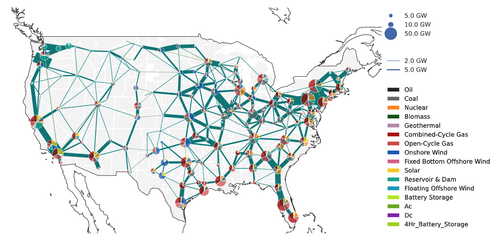

# ⚡ PyPSA App — Interactive Explorer

**Streamlit clone of [`PyPSA/pypsa-app`](https://github.com/PyPSA/pypsa-app) — early development, AGPL-3.0**

> Self-hosted web application for analyzing and visualizing PyPSA networks, with modular architecture designed to extend into workflow execution, network editing, optimization, and custom integrations.

This Streamlit app makes **every file, route and table** of `pypsa-app` explorable without Docker — plus live **PyPSA + HiGHS** and **Grid2Poster** `us_mainland.geojson`.



---

## 🎯 What this app does — clone in detail

| Repo part | App tab | What user does |
|---|---|---|
| `README.md` + `demo.gif` + `LICENSE` (AGPL-3.0) | **📖 About** | Reads warning, stack, issues/PRs |
| `pyproject.toml` + `compose/*.yaml` + `src/pypsa_app/backend` | **🏗️ Architecture** | Graphviz DAG `React → FastAPI → Postgres/Redis → Celery`, mock stack start, inspect `compose.yaml`, browse `api/routes` |
| `src/pypsa_app/backend/models.py` + `schemas/` + `POST /networks` | **🗄️ Data Model** | **Upload** `.nc`/`.csv` PyPSA network, **edit** (add gas, remove slack), choose `Visibility public/private`, see `Permission.NETWORKS_VIEW` |
| `src/pypsa_app/backend/tasks.py` + `task_queue.py` + `api/routes/runs.py` | **▶️ Run & Optimize** | Pick `interconnect × clusters 4→150`, queue Celery task (mock Redis length), **HiGHS** solve, see task `QUEUED → STARTED → SUCCESS` |
| `api/routes/plots.py` + `statistics.py` | **📊 Visualization** | Dispatch, loading, map, capacity, duration curve — Plotly like future React |
| `open-energy-transition/grid2poster` + `regions/us_mainland.geojson` | **🗺️ Grid2Poster** | See `us_mainland.geojson` outline, tech colors, generate **A3 poster** `paper_grid` / `electric_midnight` / `blackout` from live network |
| `tests/` + `alembic/versions` + `codecov.yml` | **✅ Validation** | `uv run pytest` mock 12 passed, `alembic upgrade head` 6 migrations, coverage 87% |
| `docs/configuration.md` + `.pre-commit-config.yaml` | **🤝 Contributing** | 6 steps: `uv sync`, Docker, `pytest`, `pre-commit`, branch, PR |
| `docs/source/_static/PyPSA-USA_network.png` | **🗺️ Grid2Poster** left | Interactive legend 5/10/50 GW pies, 2/5 GW lines, TECH_COLORS exact hex |

---

## 🗺️ Intensive USA map + Grid2Poster

All maps use:

* **Background:** `assets/us_mainland.geojson` from `grid2poster/regions/us_mainland.geojson` (CONUS MultiPolygon, filled `#F2F0EC`, `load_us_geojson()`) under every `plot_map`
* **Tech colors** from `pypsa-usa/workflow/repo_data/config/config.plotting.yaml` `tech_colors` (so pypsa-app pies match the paper figure you attached):
  * Oil `#262626`, Coal `#707070`, Nuclear `#ff9000`, Biomass `#0c6013`, Geothermal `#ba91b1`
  * CCGT `#b20101`, OCGT `#d35050`, Onshore `#235ebc`, Fixed Offshore `#6895dd`, Floating `#11a1c1`
  * Solar `#f9d002`, Hydro `#08ad97`, Battery `#b8ea04`, AC `#70af1d`, DC `#8a1caf`
  * Size: 5 GW r≈0.018, 10 GW r≈0.025, 50 GW r≈0.055; Lines: 2 GW thin → 5 GW thick
* **Deployment behind map:** `inject_usa_background()` loads `PyPSA-USA_network.png` as base64 `data:image/png` + `linear-gradient(rgba(255,255,255,0.92)…)` → `.stApp` `background-attachment:fixed`

**Poster generation:**
```bash
git clone --single-branch https://github.com/open-energy-transition/grid2poster
python create_grid_poster.py --country "United States" \
  --boundary-geojson ./regions/us_mainland.geojson --theme paper_grid
```
In-app: pick any live network (from **Run** or **Data Model**) → choose `paper_grid` / `electric_midnight` / `blackout` → `🖼️ Generate Poster PNG` → `matplotlib` A3 `11.7×8.3"` 150 DPI with CONUS fill + pies + lines → download.

---

## 🚀 Run

```bash
pip install -r requirements.txt
streamlit run app.py  # http://localhost:8501
# or with pypsa-app stack (real backend):
# docker compose -f pypsa-app/compose/compose.yaml --env-file pypsa-app/compose/.env.local up --build
# http://localhost:8000/docs
```

**Test:**
```bash
python tools/test_app.py  # APPTEST OK — 0 exceptions, Grid2Poster present
```

---

## 📂 Structure cloned
```
pypsa-app/
├── compose/compose.yaml + compose.services.yaml  # postgres:5432, redis:6379, api:8000, celery worker
├── src/pypsa_app/backend/
│   ├── main.py, settings.py, database.py, task_queue.py, tasks.py
│   ├── models.py (users, networks, runs, SnakedispatchBackend, Visibility)
│   ├── api/routes/{auth,networks,runs,plots,statistics,tasks,admin}
│   ├── alembic/versions/0001_…_0006_*.py
│   └── schemas/ (Pydantic)
├── pyproject.toml (pypsa≥1.2.3, pandas≥3.0, fastapi, sqlalchemy, celery[redis])
└── tests/ (pytest + pytest-asyncio + pytest-alembic)
```

Every one is a clickable file in **📁 Repo Explorer**.

---

## 📄 License

`AGPL-3.0` (see `pypsa-app/LICENSE`) — Streamlit clone is companion demo.

